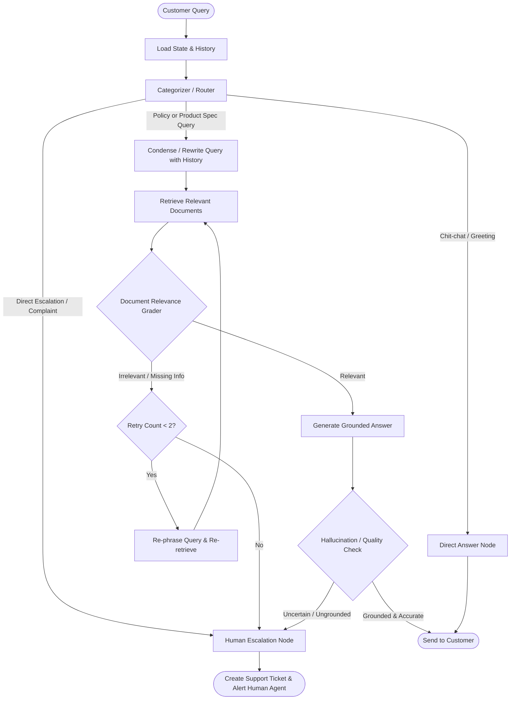

# Intelligent Customer Support Agent (Agentic RAG with LangGraph)

An end-to-end, enterprise-ready Customer Support Agent built with **Retrieval-Augmented Generation (RAG)** and **LangGraph**. Designed to handle repetitive e-commerce inquiries (product specifications, delivery, returns, warranties, and refunds), maintain multi-turn context, verify factual grounding, and gracefully escalate unresolved queries to human agents.

---

## 📌 Problem Statement

E-commerce companies receive thousands of repetitive inquiries every day regarding:
- **Product Specifications:** Dimensions, compatibility, setup instructions, troubleshooting.
- **Store Policies:** Delivery timelines, return windows, warranty claim processes, and refund eligibility.

Standard LLM solutions often hallucinate company policies, lack access to up-to-date product manuals, and fail to hand off critical cases to human support. This project implements an **Agentic RAG workflow** using LangGraph to solve these challenges with deterministic routing, grounded retrieval, conversational memory, and human-in-the-loop escalation.

---

## 🏗️ Architecture & Workflow



---

## 🚀 Key Features

- **Intent-Based Routing:** Classifies user queries into specific policy domains, product manuals, chit-chat, or direct human escalation.
- **Multi-Source RAG:** Vector search across company policies (returns, warranties, shipping) and product manuals with metadata filtering.
- **Conversational Memory & Query Condensation:** Resolves follow-up questions and pronouns (anaphora) against chat history.
- **Corrective RAG (CRAG) & Grading:** Self-evaluates retrieved chunks for query relevance before generating an answer.
- **Hallucination Guardrails:** Validates generated responses against retrieved context to ensure factual accuracy.
- **Human-in-the-Loop Escalation:** Automatically routes unresolved questions, low-confidence retrievals, or upset customer queries to human support.

---

## 🗺️ Project Roadmap & Phases

- [x] **Phase 0:** Project initialization, Git setup, and architecture specification.
- [ ] **Phase 1:** Knowledge corpus creation (structured policies & product manuals).
- [ ] **Phase 2:** Embedding pipeline & Vector Store setup (ChromaDB + semantic search).
- [ ] **Phase 3:** Query classification & Intent router (Pydantic structured output).
- [ ] **Phase 4:** Multi-turn conversational memory & Query condensation rewriter.
- [ ] **Phase 5:** LangGraph state machine assembly (nodes, conditional edges, CRAG, human handoff).
- [ ] **Phase 6:** End-to-end evaluation, stress testing edge cases, and interactive chat interface.

---

## 🛠️ Tech Stack

- **Framework:** [LangGraph](https://github.com/langchain-ai/langgraph), [LangChain](https://github.com/langchain-ai/langchain)
- **Vector Database:** [ChromaDB](https://www.trychroma.com/)
- **Embeddings & LLM:** Google Gemini (`gemini-2.5-flash`) / OpenAI / Groq
- **Language:** Python 3.11+
- **Validation:** Pydantic v2

---

## 🚦 Getting Started

### 1. Clone the repository
```bash
git clone https://github.com/your-username/ecom-support-agent-langgraph.git
cd ecom-support-agent-langgraph
```

### 2. Set up a virtual environment
```bash
python -m venv .venv
# On Windows PowerShell:
.\.venv\Scripts\Activate.ps1
# On macOS/Linux:
source .venv/bin/activate
```

### 3. Configure environment variables
```bash
cp .env.example .env
# Open .env and add your API keys
```
