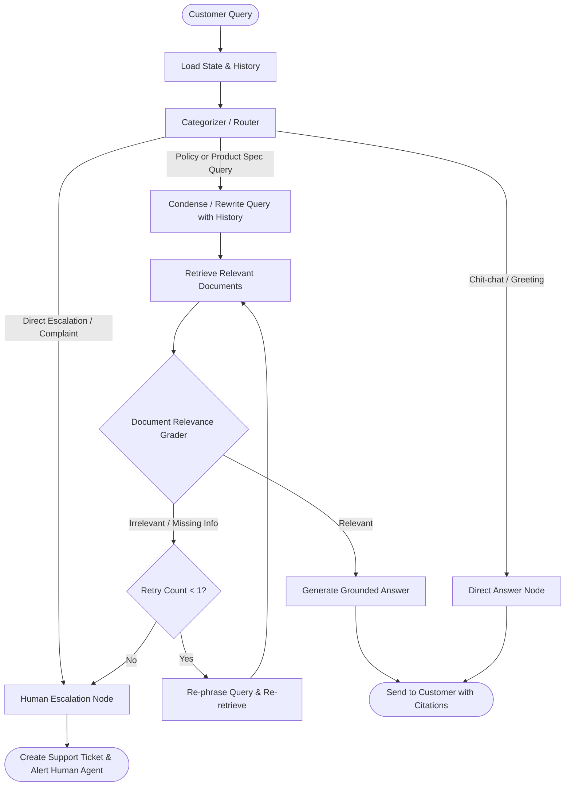

# Intelligent Customer Support Agent (Agentic RAG with LangGraph)

An end-to-end, enterprise-ready Customer Support Agent built with **Retrieval-Augmented Generation (RAG)** and **LangGraph**. Designed to handle repetitive e-commerce inquiries (product specifications, delivery, returns, warranties, and refunds), maintain multi-turn context, verify factual grounding, and gracefully escalate unresolved queries to human agents.

---

## 📌 Problem Statement

An e-commerce company receives repetitive customer queries about:
- **Product Specifications:** Dimensions, compatibility, setup instructions, troubleshooting, user manuals.
- **Store Policies:** Delivery timelines, return windows, warranty claim processes, and refund eligibility.

Standard LLM solutions often hallucinate company policies, lack access to up-to-date product manuals, and fail to hand off critical cases to human support. This project implements an **Agentic RAG workflow** using LangGraph to solve these challenges with deterministic routing, grounded retrieval, conversational memory, and human-in-the-loop escalation.

---

## 🏗️ Architecture & Workflow



---

## 🚀 Key Features

- **Intent-Based Routing (Phase 3):** Classifies user queries into specific policy domains, product manuals, chit-chat, or direct human escalation using Pydantic structured output.
- **Multi-Source RAG (Phase 2):** Vector search across company policies (returns, warranties, shipping) and product manuals with metadata filtering in ChromaDB.
- **Conversational Memory & Query Condensation (Phase 4):** Resolves follow-up questions and pronouns (anaphora) against chat history.
- **Corrective RAG (CRAG) & Grading (Phase 5):** Evaluates retrieved chunks for query relevance before generating an answer.
- **Human-in-the-Loop Escalation (Phase 5):** Automatically routes unresolved questions, low-confidence retrievals, or upset customer queries to human support with unique ticket IDs.
- **Interactive CLI (Phase 6):** Real-time conversational terminal interface with intent badges and `/reset` support.

---

## 🗺️ Completed Project Roadmap

- [x] **Phase 0:** Project initialization, Git setup, and architecture specification.
- [x] **Phase 1:** Knowledge corpus creation (`data/policies` and `data/manuals`).
- [x] **Phase 2:** Embedding pipeline & Vector Store setup (`ChromaDB` + Gemini Embeddings).
- [x] **Phase 3:** Query classification & Intent router (`src/agent/router.py` with Pydantic).
- [x] **Phase 4:** Multi-turn conversational memory & Query rewriter (`src/agent/rewriter.py`).
- [x] **Phase 5:** LangGraph state machine assembly (`src/agent/graph.py` with CRAG & escalation).
- [x] **Phase 6:** End-to-end verification suite, interactive CLI (`main.py`), and documentation.

---

## 📂 Project Structure

```text
ecom-support-agent-langgraph/
├── data/
│   ├── manuals/
│   │   ├── aero_sound_pro_headphones.md
│   │   └── lumismart_desk_lamp.md
│   └── policies/
│       ├── return_and_refund.md
│       ├── shipping_and_delivery.md
│       └── warranty.md
├── src/
│   ├── agent/
│   │   ├── graph.py       # LangGraph state machine & conditional edges
│   │   ├── nodes.py       # Functional nodes (route, rewrite, retrieve, grade, generate)
│   │   ├── rewriter.py    # Conversational query condenser
│   │   ├── router.py      # Pydantic-powered intent classifier
│   │   └── state.py       # AgentState TypedDict
│   └── rag/
│       └── vector_store.py# ChromaDB loading, chunking, and similarity search
├── tests/
│   ├── test_retrieval.py  # Phase 2 vector search tests
│   ├── test_router.py     # Phase 3 intent classification tests
│   ├── test_rewriter.py   # Phase 4 multi-turn rewriting tests
│   ├── test_graph.py      # Phase 5 state machine workflow tests
│   └── test_end_to_end.py # Phase 6 end-to-end integration tests
├── .env.example
├── .gitignore
├── main.py                # Interactive CLI application
├── README.md
└── requirements.txt
```

---

## 🚦 Getting Started

### 1. Clone & Set Up Virtual Environment
```powershell
git clone https://github.com/<your-username>/ecom-support-agent-langgraph.git
cd ecom-support-agent-langgraph

python -m venv .venv
.\.venv\Scripts\Activate.ps1
pip install -r requirements.txt
```

### 2. Configure Your API Key
Copy `.env.example` to `.env` and insert your Gemini API Key:
```env
GEMINI_API_KEY=AIzaSy...your_gemini_api_key_here
```
*(Get a free key at [Google AI Studio](https://aistudio.google.com/apikey))*

### 3. Run the Interactive Support Agent
```powershell
python main.py
```

### 4. Run the Test Suites
```powershell
# Test ChromaDB Retrieval
python tests/test_retrieval.py

# Test Intent Router
python tests/test_router.py

# Test Conversational Query Rewriting
python tests/test_rewriter.py

# Test Complete LangGraph Workflow
python tests/test_graph.py
```
